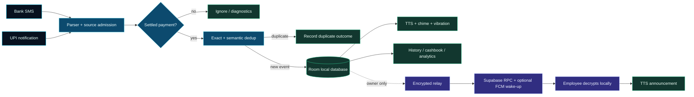

# PayAlert

<p align="center">
  
</p>

<div align="center">
  
</div>

<div align="center">
  
  &nbsp;
  
  &nbsp;
  
  &nbsp;
  
  &nbsp;
  
  &nbsp;
  
</div>

<div align="center">
  <b>Animated hero stats</b>
  &nbsp;
  
  &nbsp;
  
  &nbsp;
  
  &nbsp;
  
</div>

<div align="center">
  
</div>

<p align="center">
  
</p>

<div align="center">
  
</div>

---

# 📱 For Users — Download and Use PayAlert

<div align="center">
  
</div>

<div align="center">
  <b>📲 Two quick ways to get PayAlert — pick one</b>
</div>

<div align="center">
  
  &nbsp;&nbsp;
  
</div>

<div align="center">
  
</div>

| 🔗 **Option 1** | 🔗 **Option 2** |
|---|---|
| **GitHub Releases** — download the signed release APK directly.<br><br><a href="https://github.com/vivekray898/payalert/releases"></a><br><br><sub>Pick the latest release, download the APK, install on your Android device.</sub> | **Betadrop quick install** — tap the link on your Android device and follow the install prompt.<br><br><a href="https://betadrop.app/i/XrKM4v"></a><br><br><sub>No compilation. No coding. No setup script. Plug and play.</sub> |

<div align="center">
  
</div>

<div align="center">
  
</div>

<div align="center">
  
</div>

<div align="center">
  
</div>

<div align="center">
  
</div>

<div align="center">
  
</div>

<div align="center">
  
</div>

<div align="center">
  <b>Optional team mode</b>
</div>

<div align="center">
  
</div>

<div align="center">
  
</div>

<div align="center">
  
  &nbsp;
  
</div>

<div align="center">
  
</div>

---

# 🛠️ For Developers — Build from Source

<div align="center">
  
</div>

<div align="center">
  
</div>

<div align="center">
  
</div>

<div align="center">
  
</div>



<div align="center">
  
</div>

<div align="center">
  
</div>

<div align="center">
  
</div>

<div align="center">
  
</div>

<div align="center">
  
  &nbsp;&nbsp;
  
</div>

```bash
git clone https://github.com/vivekray898/payalert.git payalert
cd payalert
make setup
```

<div align="center">
  
  &nbsp;&nbsp;
  
</div>

```bash
make build
adb install -r app/build/outputs/apk/debug/app-debug.apk
adb shell am start -n com.vivekray898.payalert/.ui.MainActivity
```

<div align="center">
  
</div>

<div align="center">
  
</div>

<div align="center">
  <b>Optional Supabase team pairing</b>
</div>

<div align="center">
  
</div>

<div align="center">
  
</div>

<div align="center">
  
  &nbsp;&nbsp;
  
</div>

<div align="center">
  
</div>

<div align="center">
  
</div>

<div align="center">
  
</div>

<div align="center">
  
</div>

<p align="center">
  
</p>

<div align="center">
  
</div>
