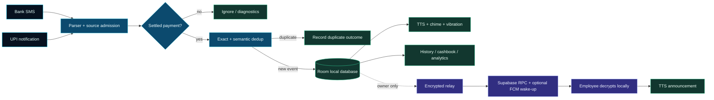

# PayAlert

<p align="center">
  
</p>

<div align="center">


**A local-first Android payment alert, cashbook, reminder, and team announcement app.**

<br />

[](app/build.gradle.kts)
[](https://developer.android.com/)
[](https://kotlinlang.org/)
[](https://developer.android.com/compose)
[](https://supabase.com/)
[](https://gradle.org/)

<br />

<sub>Detect locally → format clearly → announce immediately → optionally relay securely.</sub>

<br />
<br />

| 🧠 **DETECTION** | ⚡ **RESPONSE** | 🔐 **PRIVACY** | 🌐 **OPTIONAL RELAY** |
|:---:|:---:|:---:|:---:|
| SMS + UPI notifications | TTS + chime + vibration | Room local-first storage | Supabase + FCM |

</div>

---

## Why PayAlert?

PayAlert turns payment notifications and bank SMS messages into spoken, visible, searchable alerts. It is designed for counters, shops, family businesses, and teams where the person receiving a payment is not always the person who needs to hear about it.

### Search-friendly overview

PayAlert is an **Android payment notification app**, **bank SMS alert app**, **UPI payment announcer**, **cashbook tracker**, and optional **owner-to-employee payment relay**. It supports local-first operation with Room, Android notification-listener detection, bank SMS parsing, Text-to-Speech announcements, reminders, transaction history, analytics, export, backup, QR payment links, and optional encrypted team pairing with Supabase and Firebase Cloud Messaging.

## ✨ Feature highlights

| Area | What PayAlert provides |
|---|---|
| **Payment detection** | Reads supported payment notifications and bank SMS messages after the user grants Android permissions. |
| **Spoken announcements** | Uses Android Text-to-Speech with language, speed, pitch, volume, chime, vibration, and template controls. |
| **Short default wording** | `Payment received {amount} in your bank account.` — no sender name is spoken by default. |
| **Duplicate protection** | Suppresses repeated notification/SMS versions of the same payment using persistent exact and semantic deduplication. |
| **Transaction history** | Search, filter, date ranges, direction totals, account filters, details, CSV/JSON export, and analytics. |
| **Cashbook** | Track money in/out with labels, categories, notes, reports, editing, deletion, and export. |
| **Upcoming payments** | Create one-time or repeating reminders, mark them paid, and automatically roll recurring reminders forward. |
| **Team devices** | Pair an owner device with employee devices using Google sign-in and a single-use pairing code. |
| **Encrypted relay** | Forward owner-side credits to employees using device-generated keys and encrypted envelopes. |
| **Push wake-up** | Optional high-priority FCM wake-up for near-instant remote delivery when the Supabase webhook is configured. |
| **Offline-first core** | Local payment detection, history, cashbook, reminders, QR links, export, backup, and TTS work without an account. |
| **Diagnostics** | Inspect permissions, service health, parser results, relay status, and recovery actions. |
| **No monetization** | No subscriptions, paywalls, ads, attribution SDKs, or payment gateway are required by this project. |

## 🛰️ Mission control

<div align="center">

| **CURRENT RELEASE** | **LOCAL SIGNAL LOOP** | **DEDUP HORIZON** | **REMOTE FALLBACK** |
|:---:|:---:|:---:|:---:|
| `v1.1.0` · code `2` | SMS + notifications → Room → TTS | 5 min exact · 10 min semantic | ~30 sec polling |

</div>

PayAlert is intentionally designed as a **signal layer**, not a payment processor. It observes the
signals already exposed by Android, converts them into a normalized event, and keeps the result useful
even when the cloud layer is unavailable.

## 🧬 Signal architecture



<details>
<summary><strong>▸ Read the flow like a dashboard</strong></summary>

```text
INPUTS              TRUSTED CORE                 OUTPUTS
────────             ────────────                 ───────
Bank SMS       ───┐  normalize                    local history
UPI notices    ───┼─▶ parse ─▶ filter ─▶ dedup ─▶ TTS alert
Mirror apps    ───┘       settled?               optional relay
```

The local path is the source of truth for the device. Remote delivery is an optional encrypted copy
of eligible owner-side credits, not a replacement for local history.

</details>

<details>
<summary><strong>🎬 The product loop</strong></summary>

```text
┌──────────────────────┐
│ Bank SMS / payment   │
│ app notification      │
└──────────┬───────────┘
           │
           ▼
┌──────────────────────┐      ┌──────────────────────┐
│ Parser + dedup       │─────▶│ Room local database  │
│ amount / bank / UTR  │      │ history + cashbook   │
└──────────┬───────────┘      └──────────────────────┘
           │
           ▼
┌──────────────────────┐
│ TTS + chime + alert  │
│ Payment received ...  │
└──────────┬───────────┘
           │ optional owner role
           ▼
┌──────────────────────┐      ┌──────────────────────┐
│ Encrypted relay      │─────▶│ Employee device      │
│ Supabase RPC / FCM   │      │ decrypt + announce   │
└──────────────────────┘      └──────────────────────┘
```

</details>

## 🧭 How the app is organized

PayAlert has four primary destinations and a **More tools** menu:

| Destination | Use it for |
|---|---|
| **Home** | See money-in/money-out totals, detection health, recent payments, and quick actions. |
| **History** | Search and inspect detected payments, filter by direction/date/account, export, and open analytics. |
| **Payment QR** | Create and share a UPI payment link/QR without camera scanning. |
| **Settings** | Configure detection, permissions, speech, announcement text, sound, deduplication, backup, help, and team pairing. |
| **More → Cashbook** | Track manual income and expenses and generate reports. |
| **More → Upcoming payments** | Schedule one-time or recurring reminders. |
| **More → Analytics** | Review totals, categories, payees, daily movement, and CSV summaries. |
| **More → Team & devices** | Pair owners and employees, refresh membership, remove devices, and inspect forwarding status. |
| **Settings → Diagnostics** | Run a real pipeline test and inspect service/permission/relay state. |
| **Settings → Help & FAQ** | Read common setup and privacy guidance. |
| **Settings → Privacy & terms** | Review the local-first data and permission model. |

## 🔊 Announcement wording

The built-in credit announcement is intentionally short:

> **Payment received 750 rupees in your bank account.**

The default credit template does **not** speak the merchant or sender name. Merchant, bank, account, reference, and raw source fields can still remain available in local history and diagnostics where appropriate.

Supported template placeholders:

| Placeholder | Meaning |
|---|---|
| `{amount}` | Spoken amount, such as `1,234 rupees 50 paise`. |
| `{merchant}` | Parsed merchant, VPA, or sender label. |
| `{bank}` | Parsed bank or payment source. |
| `{kind}` | `credit` or `debit`. |

To customize the spoken sentence:

1. Open **Settings**.
2. Open the announcement/template section.
3. Edit the credit or debit template.
4. Use **Preview** before saving.
5. Clear the custom credit template or reset settings to return to the short built-in wording.

## 🔐 Local-first privacy model

PayAlert does not require an account for its core features. Local payment records, cashbook entries, reminders, settings, and received announcements are stored on the Android device using Room and Android storage facilities.

Optional team forwarding is separate from local detection:

- The owner device detects and announces its own payments.
- Employee devices intentionally stop processing their own SMS and payment notifications.
- Only eligible owner-side credits are forwarded.
- Device identity keys are generated locally.
- The relay uses an X25519-derived shared secret and AES-256-GCM encrypted envelopes.
- The server stores routing metadata and opaque ciphertext, not plaintext payment details.
- The employee decrypts locally before storing and announcing the payment.
- Received announcements are retained locally for the configured retention period; the relay is not a history backup.
- Never place service-role keys, FCM service-account JSON, OAuth secrets, or private tokens in the APK or repository.

## ⚡ Remote announcement delivery: what is actually instant?

Same Wi-Fi is **not** a direct transport in the current architecture. Phones communicate with the configured backend over HTTPS.

| State | Delivery behavior |
|---|---|
| **FCM configured and healthy** | Supabase webhook sends a high-priority data-only wake-up containing only a message ID; the employee then fetches the encrypted envelope through an authenticated RPC. |
| **FCM unavailable, employee relay service alive** | The employee uses a low-usage polling fallback at approximately 30-second intervals. |
| **App services not alive** | WorkManager provides a slower background recovery path with Android scheduling constraints. |
| **No backend configuration** | Local-only features continue to work; remote team delivery is not available. |

For the best remote latency, complete the optional Supabase + FCM setup below. The app never sends payment plaintext through FCM.

## ⚠️ Production watch-outs

PayAlert is deliberately transparent about the hard part of payment detection: Android exposes
notifications and SMS messages, not a universal, authoritative payment event API. Banks, UPI apps,
messaging apps, and device manufacturers can all emit different copies of the same transaction.

### 👻 Ghost notifications and delayed replays

UPI apps and SMS providers can sometimes emit a **ghost notification**: a delayed, repeated, stale, or
intermediate message that looks payment-like but is not a new settlement. Common examples include:

- A UPI app posts the payment first and the bank sends an SMS several minutes later.
- An app reposts an old notification after Android reconnects the notification listener.
- A messaging or caller-ID app mirrors the bank SMS as its own notification.
- A payment app sends a `pending`, `processing`, retry, reversal, or “check details” message before the
  final settled result.
- The same amount and merchant appear again, but the source app uses a new notification identity.

The pipeline already has several safety layers:

| Guard | Current behavior |
|---|---|
| **Source admission** | Only configured bank/UPI sources or messages with a recognized payment source are considered. |
| **Skip rules** | OTPs, due reminders, promotions, delivery updates, payment requests, and declined/failed messages are rejected. |
| **SMS mirror suppression** | Known messaging/caller-ID mirrors are ignored when SMS detection is enabled. |
| **Exact deduplication** | Stable UTR/reference values and source event identities are stored persistently. |
| **Semantic deduplication** | Amount, direction, currency, account, merchant, and a rolling time window are compared across SMS and notifications. |
| **Atomic admission** | Concurrent callbacks are serialized so three UPI apps cannot all announce the same payment at once. |

### ⏱️ Why a delayed copy can still register as new

The default exact deduplication window is **5 minutes** and the semantic replay lookup currently looks
back approximately **10 minutes**. A stable UTR/reference is stronger than the time window and can still
collapse a matching event later. However, if a bank SMS or UPI replay arrives after the semantic lookback
and does not carry the same stable reference, it can be accepted as a new event.

That is a known boundary, not proof that a second payment occurred. Before acting on a suspicious second
announcement, compare:

1. UTR, RRN, or transaction ID.
2. Bank/account and source app.
3. Amount, currency, merchant, and direction.
4. The original payment timestamp versus the notification delivery timestamp.
5. The available balance or bank statement when the transaction matters financially.

Two genuine payments with the same amount and merchant close together can also be difficult to distinguish
when the provider omits a UTR. For high-value workflows, treat the bank statement or UTR as authoritative,
not the spoken announcement alone.

### 🧯 What users should do when an alert looks wrong

1. Open **History** and inspect the source, merchant, account, reference, and received time.
2. Open **Settings → Diagnostics** and check the last parser outcome.
3. Temporarily disable either **SMS detection** or **notification detection** to isolate the source.
4. Use the notification-source allowlist when a device has a noisy wallet or mirror app.
5. Keep battery optimization disabled; a reconnect can replay notifications on some Android builds.
6. Do not use PayAlert alone to confirm settlement. Verify the bank/UPI app or statement for disputes,
   refunds, reversals, or high-value payments.

## 🧭 Areas still needing improvement

The current release is usable, but these are honest improvement areas for future iterations:

- **Long-delay reconciliation:** correlate a notification and SMS beyond the current lookback using a
  stronger persisted UTR/RRN matching and a review queue instead of silently accepting every late copy.
- **Ghost-event quarantine:** distinguish `pending`, `processing`, retry, reversal, refund, and final
  settlement states more explicitly, then announce only the state the user trusts.
- **Provider format coverage:** bank and UPI wording changes without notice. New app versions need new
  parser fixtures and device-level verification.
- **Ambiguity UX:** show a visible “possible duplicate / needs review” state when amount, merchant, and
  timing match but the provider omits a stable reference.
- **OEM reliability:** background execution, notification listener reconnects, TTS engines, and battery
  policies vary across Samsung, Xiaomi, OnePlus, Pixel, and other Android builds.
- **Remote end-to-end confidence:** FCM + Supabase delivery still needs a real two-device test with the
  project's production configuration; the local fallback is intentionally slower.
- **Release automation:** versioning is now explicit in Gradle, but release signing, changelog
  generation, and a public APK/release pipeline still need to be connected for distribution.

---

## 🚀 Use the app

### First launch checklist

1. Install and open PayAlert.
2. Complete the onboarding steps.
3. Enable **Notification access** so PayAlert can read supported payment notifications.
4. Grant **SMS permissions** if you want bank SMS detection.
5. Allow PayAlert notifications so it can show status and announcement notifications.
6. Keep battery optimization disabled for PayAlert if your device aggressively stops background services.
7. Confirm the Home screen shows healthy detection paths.
8. Send a small test payment or use **Settings → Diagnostics → Run through pipeline**.

### Owner mode

Owner mode is the default local role.

- The device reads its own supported payment notifications and SMS messages.
- It announces accepted credits/debits locally according to Settings.
- It stores accepted events in local history.
- If team pairing is enabled, it forwards eligible credits to paired employees through the encrypted relay.

### Employee mode

Employee mode is activated after joining an owner's team.

- Local SMS and payment-notification detection is intentionally disabled.
- The device listens for owner-forwarded payments.
- It decrypts valid envelopes locally.
- It stores the received announcement and speaks the short announcement.
- Re-pair the device if Diagnostics reports that the owner key cannot be read.

### Pair an employee device

#### On the owner phone

1. Open **Settings → Team & devices**.
2. Continue with Google sign-in.
3. Choose **I'm the owner**.
4. Tap **Create pairing code**.
5. Share the 12-character code privately. Codes use `A–F` and `0–9`, expire after 10 minutes, and work once.

#### On the employee phone

1. Open **Settings → Team & devices**.
2. Continue with Google sign-in using the employee account.
3. Choose **I'm an employee**.
4. Paste the complete pairing code.
5. Tap **Pair this device**.
6. Keep the relay notification visible while the employee service is active.

#### After pairing

- Return to the owner's Team screen and tap **Refresh devices**.
- Confirm the owner sees the employee device.
- Confirm the employee role badge is visible.
- For FCM delivery, confirm the device token is registered and the Supabase webhook is working.
- To remove a connection, use **Remove** on the owner or **Leave team** on the employee.

> Pairing shares device/team metadata and relay routing state. It does not merge local payment histories or local cashbook data.

### Record a cashbook entry

1. Open **More → Cashbook**.
2. Tap **Add entry**.
3. Choose **Money in** or **Money out**.
4. Enter the amount, label, category, note, and date if needed.
5. Save the entry.
6. Use **Report**, category filters, edit, delete, or export as needed.

### Add an upcoming payment

1. Open **More → Upcoming payments**.
2. Tap **Add reminder**.
3. Enter the label and amount.
4. Choose a one-time or repeating schedule.
5. Save the reminder.
6. Use **Mark paid** to complete it; repeating reminders roll forward to the next date.

### Export and backup

- **History → Export history** creates CSV or JSON output for the current history selection.
- **Cashbook → Export** creates a cashbook CSV.
- **Settings → Backup & restore** exports or imports local payment, cashbook, and reminder data.
- Speech preferences and authentication secrets are deliberately excluded from backup.

---

## 🛠️ Build from source

### Requirements

| Tool | Required setup |
|---|---|
| App release | **v1.1.0** · `versionCode 2` · configured in `app/build.gradle.kts`. |
| Java | Full **JDK 25**, including `jlink`; `.java-version` pins `25`. |
| Android SDK | Command-line tools plus platform `android-37.0` and build tools `36.0.0`. |
| Gradle | Use the checked-in Gradle wrapper; it pins Gradle `9.6.0`. |
| Device | Android API 24+ device or emulator; Android 14/API 34 is used by the device test workflow. |
| Optional tools | Android Studio, Make, Docker, Supabase CLI, and PostgreSQL for optional checks. |

Set `JAVA_HOME` and `ANDROID_HOME` before building:

```bash
export JAVA_HOME="/path/to/jdk-25"
export ANDROID_HOME="$HOME/Library/Android/sdk"   # macOS example
export PATH="$JAVA_HOME/bin:$ANDROID_HOME/platform-tools:$ANDROID_HOME/cmdline-tools/latest/bin:$PATH"
```

Install the Android SDK packages if needed:

```bash
sdkmanager "platform-tools" "platforms;android-37.0" "build-tools;36.0.0"
sdkmanager --licenses
```

### Fast local build

```bash
git clone <your-repository-url> payalert
cd payalert
make setup
```

`make setup` downloads project dependencies, runs JVM tests, builds the debug APK, and builds the Android test APK.

Build and install manually:

```bash
make build
adb install -r app/build/outputs/apk/debug/app-debug.apk
adb shell am start -n com.vivekray898.payalert/.ui.MainActivity
```

The debug APK output is:

```text
app/build/outputs/apk/debug/app-debug.apk
```

### Offline checks after setup

```bash
make test          # offline JVM unit tests
make build         # offline debug APK
make test-device   # connected Android device/emulator tests
make lint          # Android lint; existing legacy issues may remain
```

The project keeps dependency locking in `app/gradle.lockfile`. Do not install project dependencies globally.

## 🌌 Release signal

<div align="center">

| `v1.1.0` | `versionCode 2` | local-first | Android 24+ |
|:---:|:---:|:---:|:---:|
| current app release | upgrade-safe increment | offline core | notification + SMS paths |

<sub>Built for clarity at the counter. Designed for resilient signals, not blind automation.</sub>

</div>

<p align="center">
  
</p>
