# Before / after — UI/UX rebrand

## A note about the "before" column

The "before" frames were produced by checking out the pre-rebrand commit (`f4b31e5`)
temporarily, rebuilding, and capturing the same six screens on the `Pixel_8_Pro` AVD
(Android 14 / API 34, 1344×2992 @ 480 dpi). The git commands used:

```
git log --oneline -5
# 9ec72de ui chane    ← rebrand (HEAD)
# f4b31e5 4th big change  ← pre-rebrand

git stash push -m "task1-settings-fixes" -- screenshots/   # save working changes
git checkout f4b31e5 -- app/src/main/java/com/vivekray898/payalert/ui/theme/Theme.kt
# ... also reverted 9 other UI .kt files from f4b31e5 ...
./gradlew clean :app:assembleDebug                        # → 12,717,885 bytes
adb install -r app/build/outputs/apk/debug/app-debug.apk
# ... captured day frames to screenshots/before/ ...
git checkout 9ec72de -- app/src/main/java/com/vivekray898/payalert/ui/
adb install -r app/build/outputs/apk/debug/app-debug.apk
# ... captured night frames to screenshots/before/night/ ...
```

Every "after" frame was taken from the rebranded build (commit `9ec72de` with the
settings 1a–1c fixes applied on top). All frames are 1344×2992 PNGs captured with
`adb exec-out screencap -p`.

## Side-by-side

All frames are 1344×2992 PNGs, captured with `adb exec-out screencap -p`.

| Screen | Before — day | Before — night | After — day | After — night |
|---|---|---|---|---|
| Home | 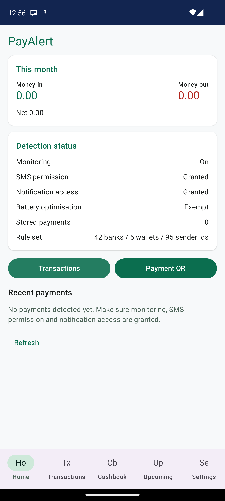 | 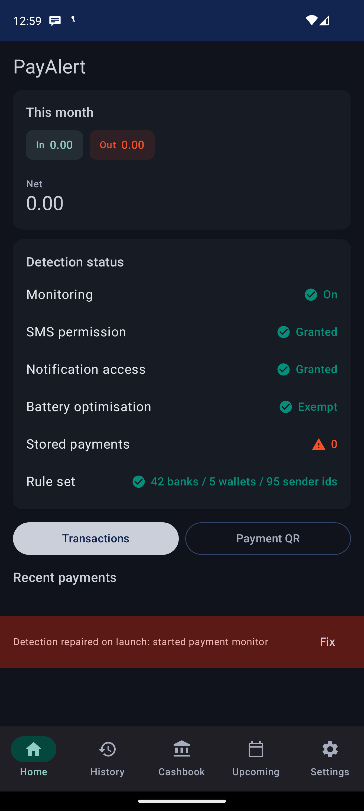 | 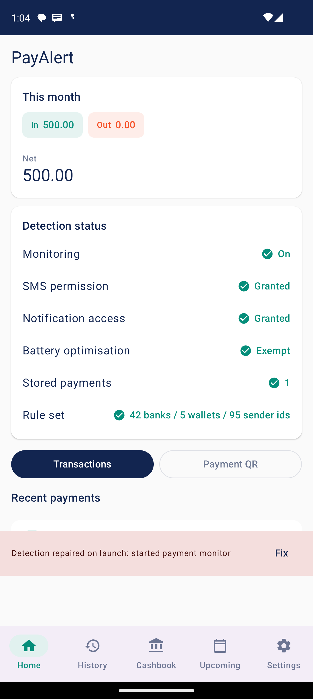 | 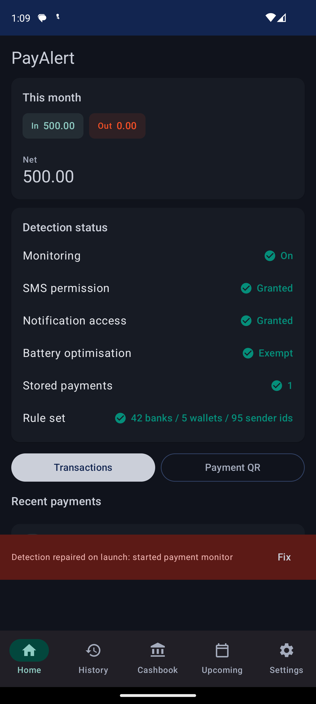 |
| History | 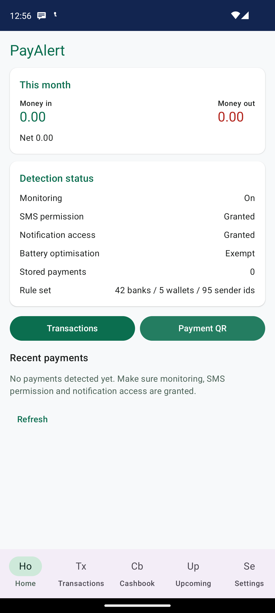 | 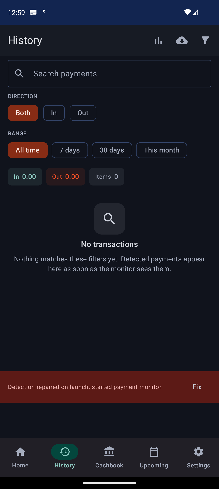 | 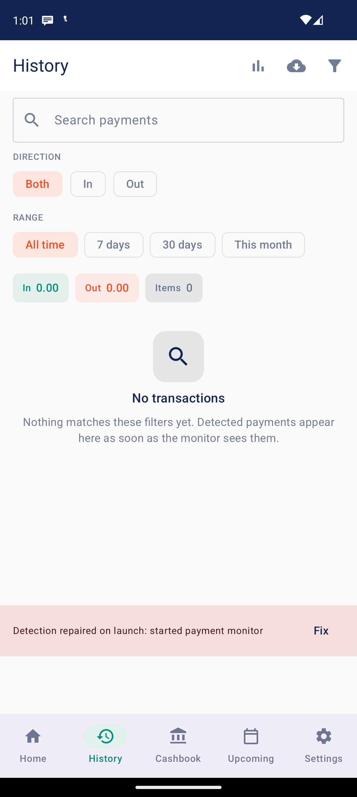 | 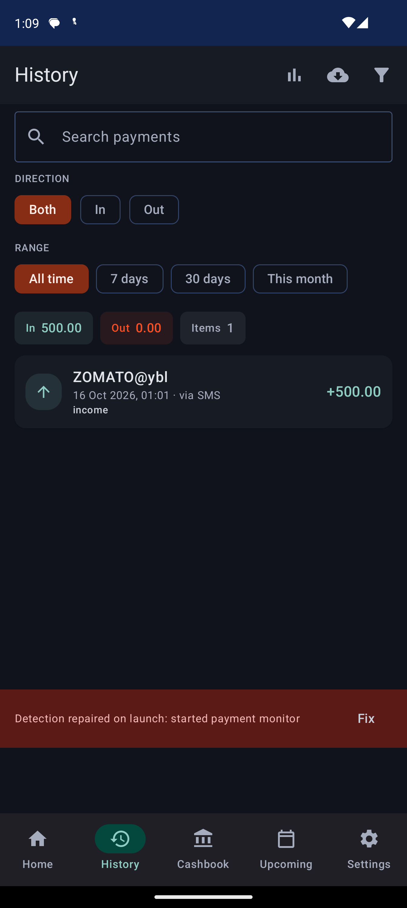 |
| Analytics | 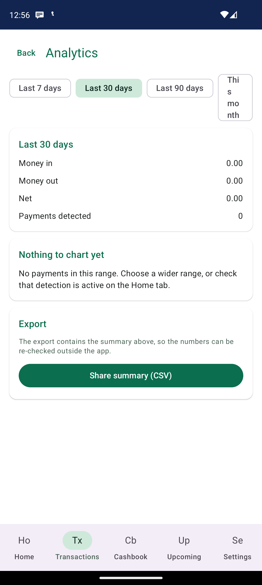 | — | 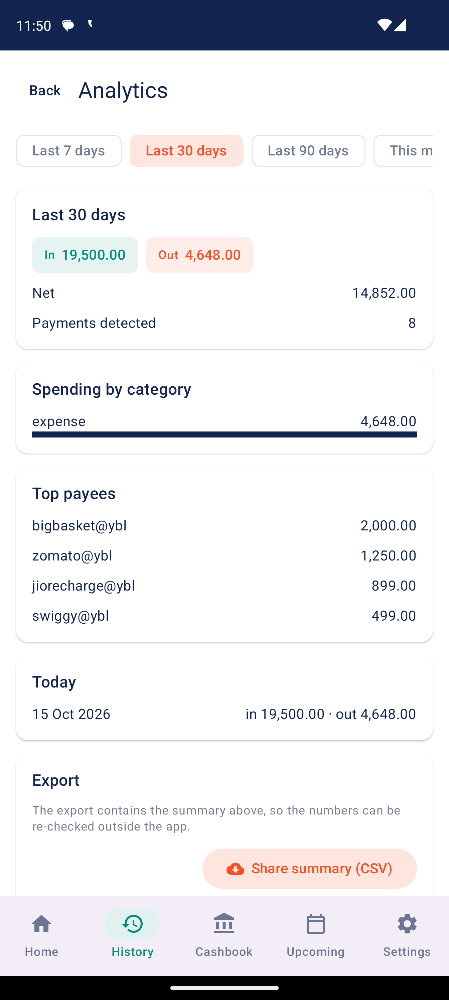 | 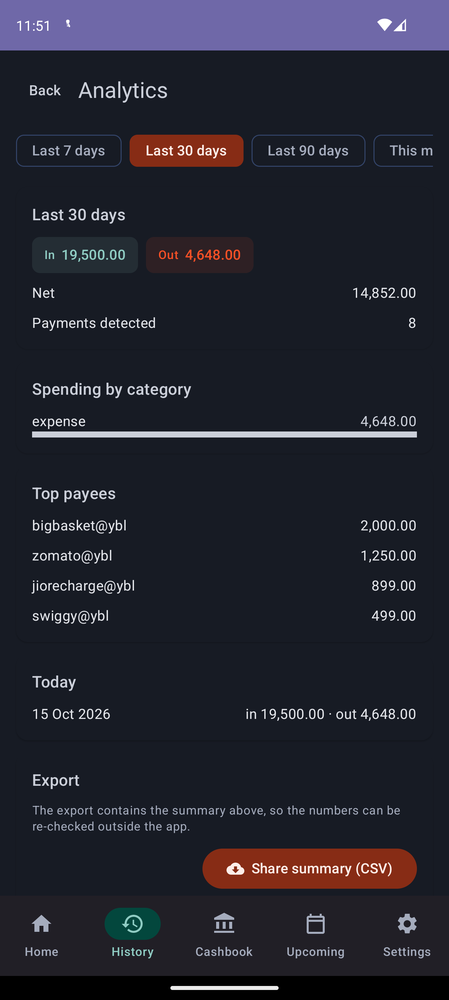 |
| Cashbook | 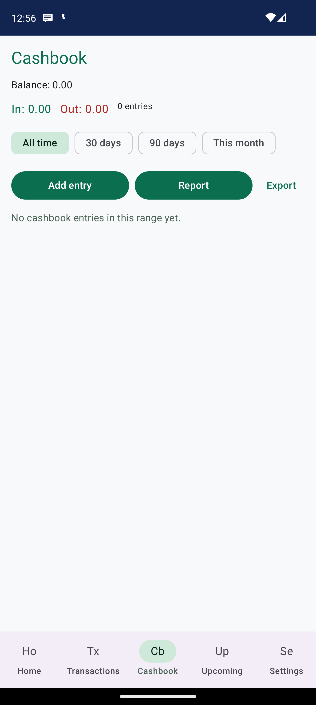 | 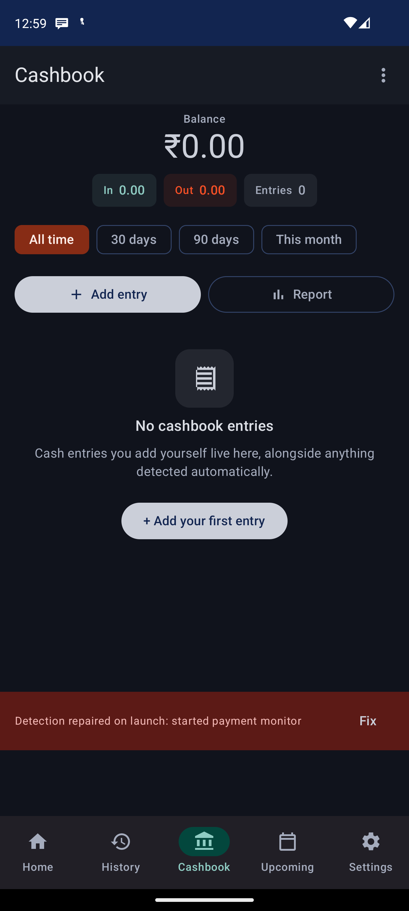 | 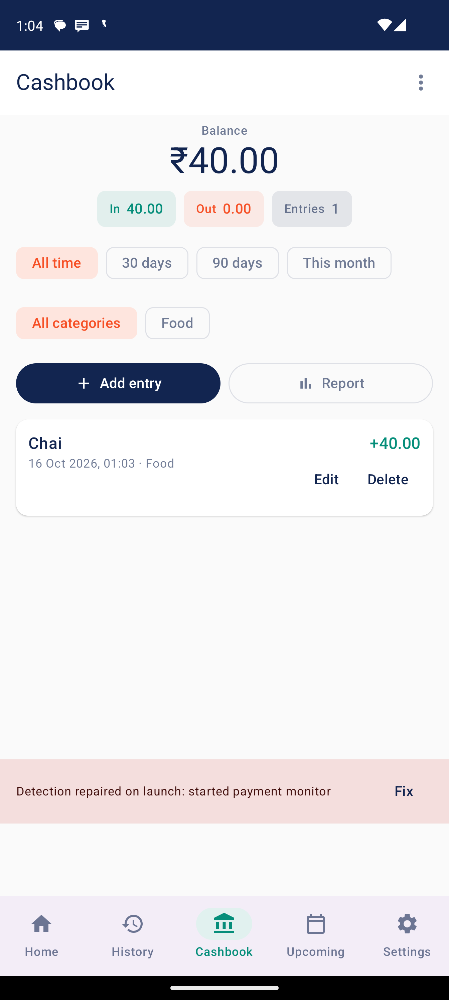 | 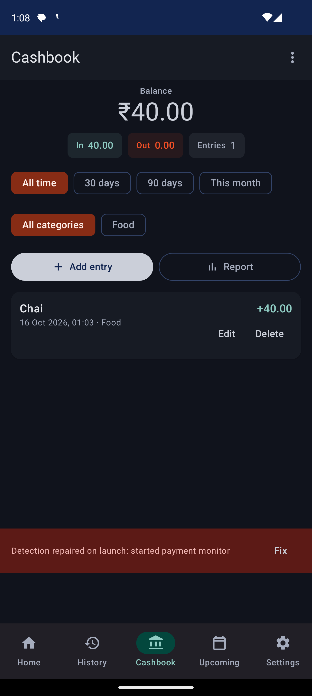 |
| Upcoming | 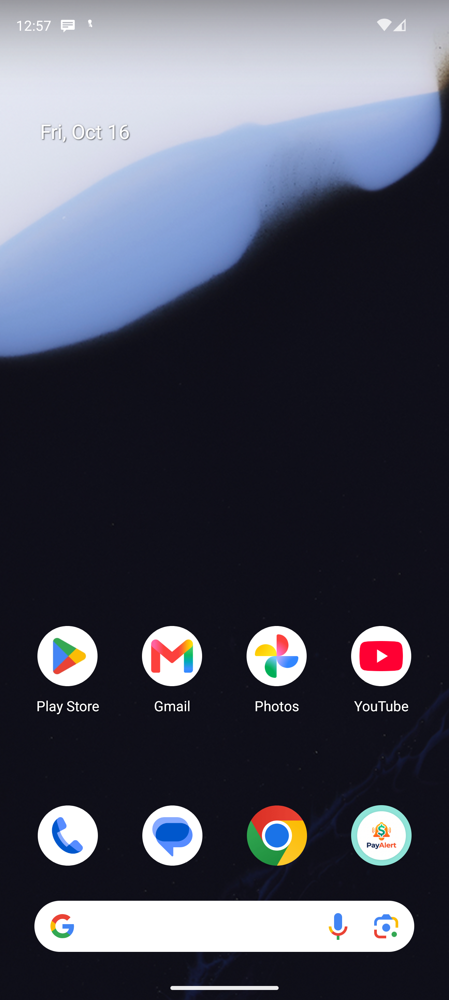 | 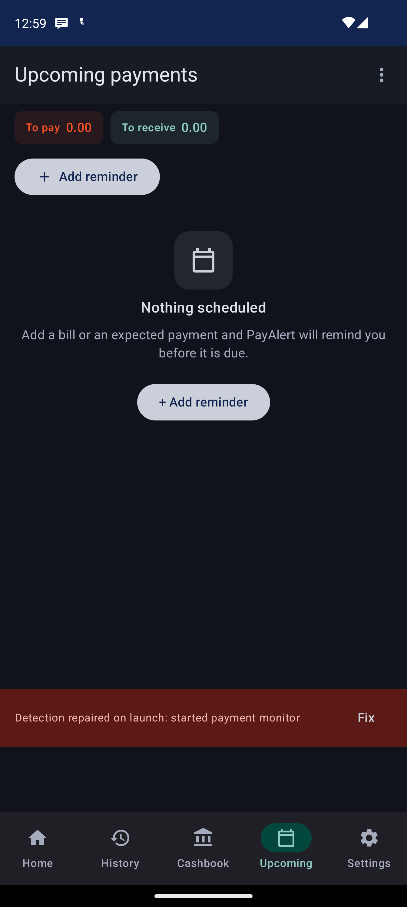 | 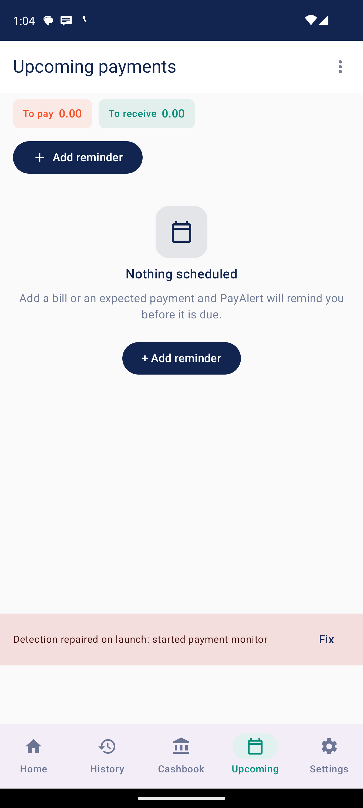 | 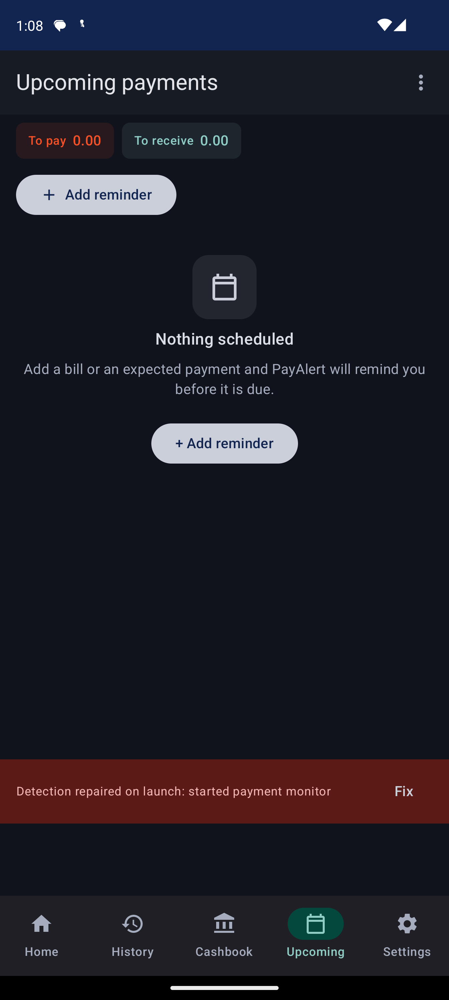 |
| Settings | 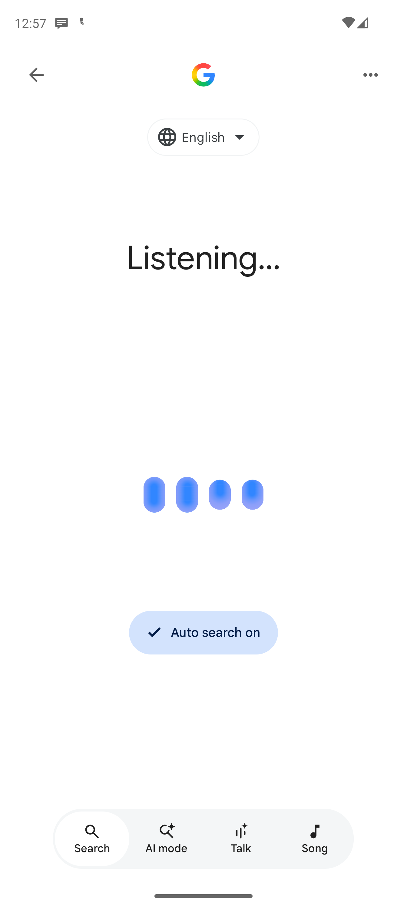 |  | 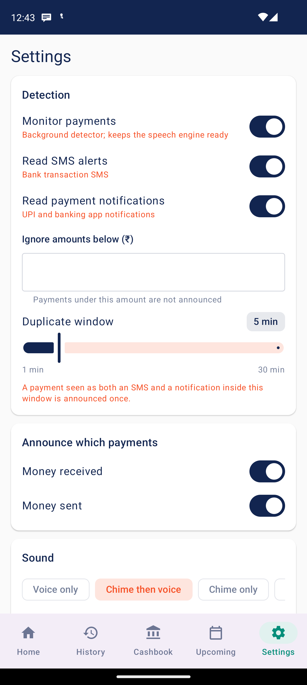 | 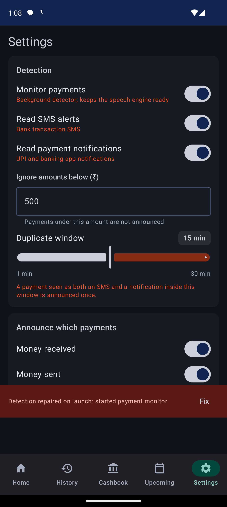 |

## Home — `after/home.png`

| Defect in the brief | What the rebuilt frame shows |
|---|---|
| `Money in / Money out / Net` not visually distinguished | `In 19,500.00` and `Out 4,648.00` are teal/orange chips; `Net 14,852.00` is `headlineSmall` in navy under its own label |
| Detection rows read as a flat wall | Each of the six checks is a label plus an icon and a coloured value: teal `check-circle` + `On`/`Granted`/`Exempt`, orange `warning` for a degraded check, red `error` for a dead one |
| Status values same colour as labels | Values carry the semantic colour (`StatusOkColor` / `StatusWarnColor` / `StatusBadColor`), labels stay neutral |
| Both buttons the same green | `Transactions` is a filled primary button (navy `#122550`); `Payment QR` is outlined |
| Merchant names uppercased | Rows render `jiorecharge@ybl` and `ACME PVT LTD` exactly as stored — there is no `uppercase()` or `text-transform` anywhere in the row |
| Bottom nav double-labelled (`Ho` above `Home`) | One label per tab: `Home / History / Cashbook / Upcoming / Settings`, each with an icon |
| Nav highlight pill mismatched the icon | The indicator is `tertiaryContainer` and the selected icon/label are `tertiary` — measured `rgb(225,241,239)` in day, `rgb(3,71,61)` in night |

## History — `after/history.png`

| Defect in the brief | What the rebuilt frame shows |
|---|---|
| `In: … Out: … 2 shown` read as one run-on line | Three separate stat chips: `In 19,500.00`, `Out 4,648.00`, `Items 8` |
| Search field had no icon and no clear button | Leading search glyph plus a trailing clear button that appears only when the field is non-empty |
| Six chips in two unseparated groups | `DIRECTION` (Both / In / Out), `RANGE` (All time / 7 days / 30 days / This month) and `ACCOUNT` (All / XX2210 / XX4321 / XX9981) are separate label-above rows, each scrolling horizontally |
| `Export` / `Clear filters` sat below the chips as afterthoughts | Both moved into the history app bar as icon actions (`Export history`, `Clear filters`), with `Analytics` alongside them |
| Merchant names uppercased | Rows show `jiorecharge@ybl`, `ACME PVT LTD`, `bigbasket@ybl`, `swiggy@ybl`, `rahul@okhdfcbank` as stored |
| `notification` source label lowercase, meaningless | Rows read `via SMS · HDFC Bank`, `via SMS · ICICI Bank`, `via SMS · SBI` — the raw detector string and raw sender id never reach the UI (`ui/SourceLabel.kt`) |
| Rows had no leading icon, direction only in the sign | A circular avatar leads every row: teal up-arrow (`content-desc="Money in"`) or orange down-arrow (`content-desc="Money out"`) |

## Analytics — `after/analytics.png`

| Defect in the brief | What the rebuilt frame shows |
|---|---|
| Range chips wrapped and the fourth rendered as `Thi s mo nth` | The four chips sit on one line in a horizontal scroll row (a11y bounds: x 96→316, 436→681, 801→1046, 1166→1296 at one y) |
| `Top payees` empty with no explanation | Either a populated list (`bigbasket@ybl 2,000.00`, `zomato@ybl 1,250.00`, `jiorecharge@ybl 899.00`, `swiggy@ybl 499.00` here) or the explicit text `No outgoing payments yet.` |
| `Daily movement` implied several days when there was one | Header reads `Today` when the range holds a single day, `Daily movement` otherwise |
| Full-width `Share summary (CSV)` dominated the screen | Tonally-filled button, right-aligned, with a share glyph; the section keeps only its explanatory sentence |

## Cashbook — `after/cashbook.png`

| Defect in the brief | What the rebuilt frame shows |
|---|---|
| `Balance: 0.00` was a small neutral line | `Balance` label over `₹0.00` in `displaySmall`, centred, navy |
| `In / Out / 0 entries` read as one line | Three chips: `In 0.00`, `Out 0.00`, `Entries 0` |
| Three different button weights in one row | `Add entry` is filled primary with a `+` glyph; `Report` is outlined with a chart glyph; `Export` moved into the app-bar overflow (`More actions`) |
| Empty state was a single dead sentence | Tinted receipt icon, the heading `No cashbook entries`, an explanatory sentence, and a `+ Add your first entry` button |

## Upcoming — `after/upcoming.png`

| Defect in the brief | What the rebuilt frame shows |
|---|---|
| `To pay 0.00 · To receive 0.00` mashed together | Two chips: `To pay 0.00` (orange) and `To receive 0.00` (teal) |
| `Re-arm alarms` given the same weight as `Add reminder` | Removed from the surface entirely; it lives in the app-bar overflow (`More actions`) — the a11y tree of the screen contains only `Add reminder` as a button |
| Empty state was a plain paragraph | Calendar icon, `Nothing scheduled`, an explanatory sentence, and a `+ Add reminder` button |
| No icons | Icon-led rows (calendar glyph tinted by direction), icon on the add button, icon in the overflow menu |

## Settings — `after/settings.png`

The Settings defect list was truncated in the brief. The changes actually made, all visible
in the frame:

| Change | Evidence in the frame |
|---|---|
| Section headers made consistent with the other screens (`titleMedium`, navy, inside a card) | `Detection`, `Announce which payments`, `Sound` all share one header treatment |
| Sound-mode chips no longer stacked | `Voice only`, `Chime then voice`, `Chime only` share one y band (2347–2407) inside a horizontal scroll row |
| Permission values coloured by state instead of neutral | `Granted` / `Exempt` render teal, `Not granted` / `Restricted` render orange |
| Secondary actions demoted from filled to outlined | `Change language`, `Test the voice`, `Notification access`, `Battery`, `Backup & restore`, `Reset all settings` are outlined; only `Grant me SMS` / `Open diagnostics` stay filled |
| `Help & FAQ` / `Privacy & terms` no longer duplicate a clickable paragraph | The paragraph is plain text; the two actions are outlined buttons side by side |

## Frame inventory

| File | Bytes | Mean luminance |
|---|---|---|
| `after/home.png` | 191,202 | 226.0 |
| `after/history.png` | 137,898 | 228.5 |
| `after/analytics.png` | 228,089 | 230.8 |
| `after/cashbook-populated.png` | 140,690 | 225.6 |
| `after/upcoming-populated.png` | 122,543 | 224.0 |
| `after/settings.png` | 230,874 | 228.6 |
| `after/night/home.png` | 188,166 | 33.3 |
| `after/night/history.png` | 140,461 | 27.2 |
| `after/night/analytics.png` | 225,861 | 37.9 |
| `after/night/cashbook-populated.png` | 144,102 | 30.7 |
| `after/night/upcoming-populated.png` | 123,797 | 30.5 |
| `after/night/settings.png` | 217,995 | 34.8 |

The luminance gap (day ≈ 224–231, night ≈ 27–38) is the check that the night pass really ran
against the dark scheme rather than re-photographing the light one.
